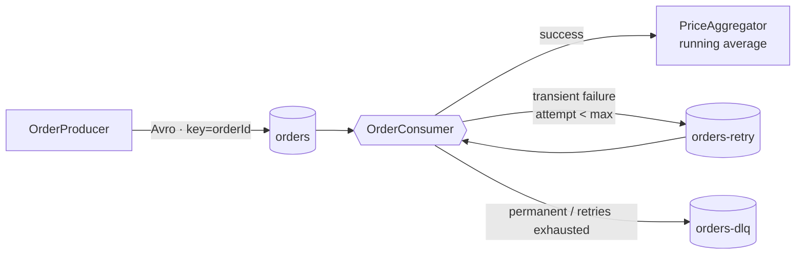

<div align="center">

# 📦 Kafka Order Processing

**A fault-tolerant Kafka pipeline in Python — Avro-encoded orders, real-time aggregation,
retry topic with exponential backoff, and a Dead Letter Queue.**


</div>

<!-- TODO: add a short GIF of the live demo (producer + consumer + kafka-ui showing a message landing in the DLQ) -->

## What it shows

Happy-path Kafka is easy. This project is about what happens when processing **fails**:



- **Avro serialization** with a shared `.avsc` schema; `orderId` as key for partition affinity.
- **Retry topic + exponential backoff** — failures leave the main partition, keeping healthy
  traffic flowing.
- **Dead Letter Queue** for poison messages, with failure metadata preserved.
- **At-least-once delivery** — retry/DLQ writes are flushed *before* the source offset is committed.
- **Configurable failure simulation** to demo every path live.

## Design trade-offs (the interview-worthy part)

| Decision | Why | What I'd do at scale |
|---|---|---|
| Retry *topic*, not in-process retry | Keeps ordering for healthy traffic; failures don't block the partition | Tiered delay topics (`retry-1s`, `-5s`, …) for fully non-blocking backoff |
| At-least-once, not exactly-once | Simpler and safe if DLQ consumers are idempotent | Kafka transactions / idempotent producer |
| In-memory aggregation | One consumer owns the running average | Kafka Streams state store or Redis for multi-consumer scaling |
| No Schema Registry | Producer and consumer load the same `.avsc` | Confluent Schema Registry for schema evolution |

## Quick start

```bash
docker compose up -d                 # Kafka + kafka-ui (:8080)
pip install -r requirements.txt
python run_consumer.py               # terminal 1
python run_producer.py               # terminal 2
pytest                               # 29 tests
```

Live demo script: [`docs/DEMO.md`](docs/DEMO.md) · Full design notes: [`SETUP.md`](SETUP.md)

---

**G.W. Niranga Niluminda** · [LinkedIn](https://linkedin.com/in/niranganiluminda)
